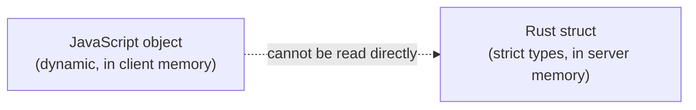
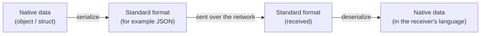
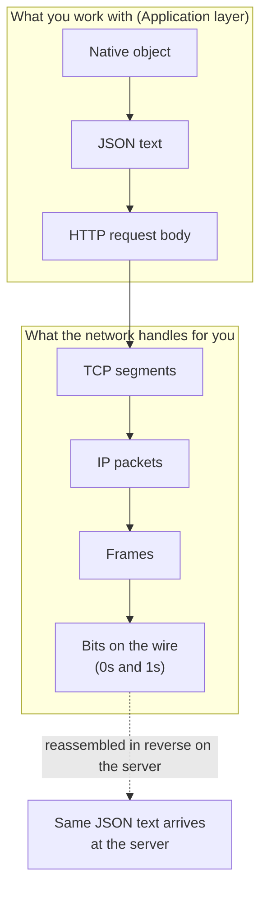
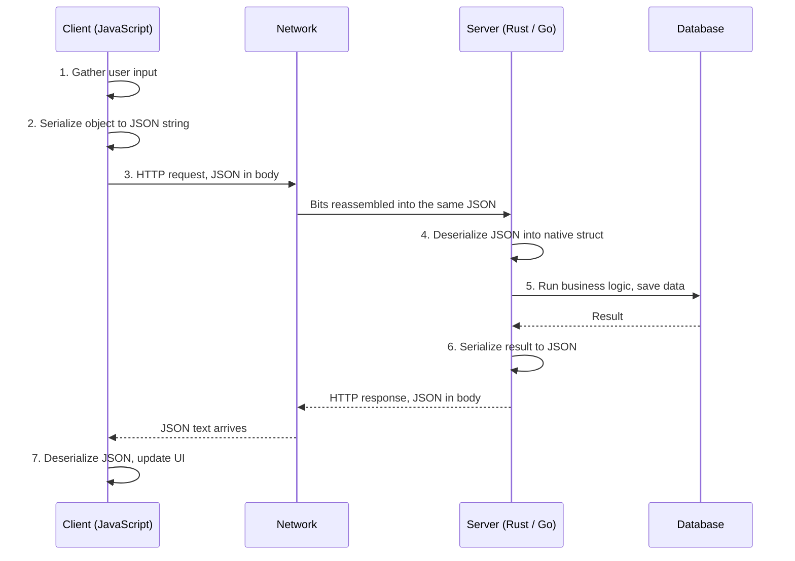
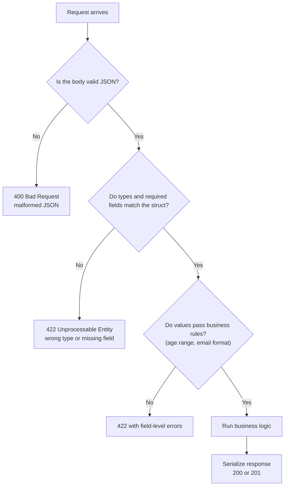
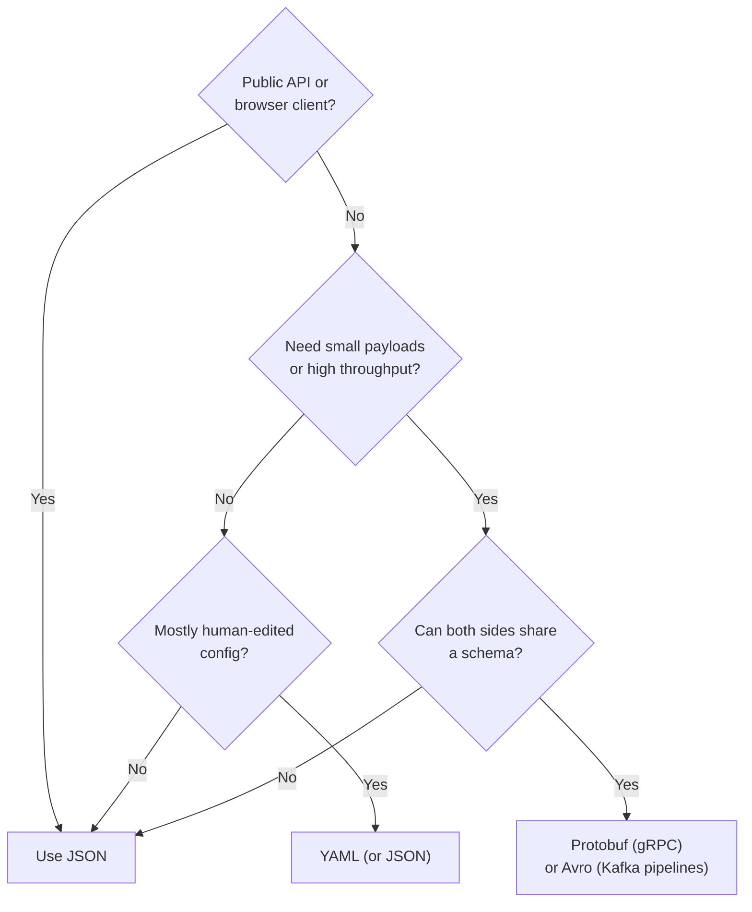

# 7. Serialization and Deserialization

Notes for backend engineers: why we need them, which formats exist, how JSON works, and how it looks in real code.

## Table of contents

1. [The core problem: language barriers](#1-the-core-problem-language-barriers)
2. [What are serialization and deserialization?](#2-what-are-serialization-and-deserialization)
3. [Types of serialization formats](#3-types-of-serialization-formats)
4. [Deep dive into JSON](#4-deep-dive-into-json)
5. [The backend engineer's mental model (OSI layers)](#5-the-backend-engineers-mental-model-osi-layers)
6. [The complete end-to-end workflow](#6-the-complete-end-to-end-workflow)
7. [Code examples](#7-code-examples)
8. [Handling bad input safely](#8-handling-bad-input-safely)
9. [Common JSON pitfalls](#9-common-json-pitfalls)
10. [Text vs binary: JSON vs Protobuf](#10-text-vs-binary-json-vs-protobuf)
11. [Choosing a format](#11-choosing-a-format)
12. [Security notes](#12-security-notes)
13. [Quick revision cheat sheet](#13-quick-revision-cheat-sheet)

---

## 1. The core problem: language barriers

- **Different environments:** a typical web app has a client (a frontend in JavaScript) and a server (a backend in a language like Rust or Go).
- **Incompatible data types:** the two languages handle data very differently. JavaScript is dynamic and not compiled. Rust is compiled and has extremely strict types.
- **The challenge:** when a JavaScript client sends an in-memory object over the internet, the Rust server cannot natively understand or parse JavaScript data structures. A memory layout is not something you can ship across a network. To communicate, both sides need a universal language.



---

## 2. What are serialization and deserialization?

Both sides agree on **one common, standard format** for transmitting data.

| Term | Meaning | Direction |
|---|---|---|
| **Serialization** | Convert native data (a JS object, a Rust struct, a Go struct) into the standard format before sending it | Native → standard format |
| **Deserialization** | Parse the standard format back into the machine's own native type so it can run business logic | Standard format → native |

**Purpose:** data transmission becomes language-agnostic and platform-agnostic. Any machine can talk to any other machine, whatever technology each one uses.



A good analogy is shipping a flat-pack wardrobe. You take it apart into a standard box (serialize), move the box, and the receiver assembles it again (deserialize). The box is the same no matter who built the wardrobe or who receives it.

---

## 3. Types of serialization formats

Formats fall into two categories:

1. **Text-based formats** are human-readable. Examples: **JSON**, **YAML**, **XML**.
2. **Binary formats** are compiled into raw binary for compact, efficient transmission. Examples: **Protobuf**, **Avro**.

| Format | Type | Human-readable | Size | Needs a schema | Typical use |
|---|---|---|---|---|---|
| JSON | Text | Yes | Medium | No | REST APIs, logs, config |
| YAML | Text | Yes | Medium | No | Config files (Kubernetes, CI) |
| XML | Text | Yes | Large | Optional (XSD) | Legacy and enterprise systems, SOAP |
| Protobuf | Binary | No | Very small | Yes (`.proto`) | gRPC, microservices |
| Avro | Binary | No | Very small | Yes | Kafka, big data pipelines |

---

## 4. Deep dive into JSON

For traditional HTTP REST APIs, **JSON (JavaScript Object Notation)** is the most popular serialization standard, used roughly 80% of the time.

**Use cases**
- Data transmission over HTTP
- Application logging (structured logs)
- Configuration files

**Characteristics**
- Despite the name, it is **not limited to JavaScript**. Every major language has a JSON library.
- Entirely human-readable.

### Strict syntax rules

- A JSON object starts with `{` and ends with `}`.
- **Keys** must be strings wrapped in **double quotes** (`"name":`).
- **Values** are limited to: string, number, boolean, `null`, array, or a nested JSON object.
- No comments, no trailing commas, and no single quotes.

```json
{
  "name": "Asha",
  "age": 27,
  "active": true,
  "skills": ["rust", "sql"],
  "address": {
    "city": "Hyderabad",
    "pincode": "500001"
  },
  "manager": null
}
```

**Invalid JSON (common mistakes)**

```text
{ name: "Asha" }          // key not in double quotes
{ "name": 'Asha' }        // single quotes
{ "name": "Asha", }       // trailing comma
{ "age": 27 /* years */ } // comments are not allowed
```

### JSON data types at a glance

| JSON type | Example | JavaScript | Rust (serde) | Go |
|---|---|---|---|---|
| string | `"hello"` | `string` | `String` | `string` |
| number | `42`, `3.14` | `number` | `i32`, `f64`, ... | `int`, `float64` |
| boolean | `true` | `boolean` | `bool` | `bool` |
| null | `null` | `null` | `Option<T>` | pointer or zero value |
| array | `[1, 2]` | `Array` | `Vec<T>` | `[]T` |
| object | `{"a": 1}` | `Object` | `struct` | `struct` or `map` |

---

## 5. The backend engineer's mental model (OSI layers)

When data travels over the internet, it passes through many network layers (the OSI model).

- **The abstraction:** as a backend engineer you only need to focus on the **Application layer**. You can safely assume your client serializes data into JSON and sends it off.
- **The intermediate steps:** under the hood, the network turns that JSON into HTTP messages, TCP segments, IP packets, frames, and finally physical bits (`0`s and `1`s) sent as electrical or optical signals.
- **The receiving end:** before your server touches the incoming data, the network reassembles those bits back into the exact JSON text the client sent. You never deal with the intermediate conversions. You only deal with the JSON.



---

## 6. The complete end-to-end workflow

1. **Client prepares data:** the frontend JavaScript app gathers user input.
2. **Serialization (client):** the client converts its internal data into a JSON string and attaches it to the HTTP request body.
3. **Transmission:** the data is broken into bits, travels across the internet, and reaches the backend server.
4. **Deserialization (server):** the server receives the JSON string and parses it into its own native format (for example a Rust struct).
5. **Processing:** the server runs its business logic (for example saving to a database).
6. **Serialization (server):** the server packages its response, converts it to JSON, and sends the HTTP response back.
7. **Deserialization (client):** the frontend receives the JSON, converts it into a JavaScript object, and updates the UI.



Two HTTP headers tell each side which format is in the body:

```http
POST /api/users HTTP/1.1
Content-Type: application/json     <- "the body I am sending is JSON"
Accept: application/json           <- "please reply with JSON"

{"name":"Asha","age":27}
```

---

## 7. Code examples

All three examples use the same payload:

```json
{ "name": "Asha", "age": 27, "skills": ["rust", "sql"], "active": true }
```

### 7.1 Client: JavaScript (serialize, send, deserialize)

```js
// 1. Native JavaScript object
const user = {
  name: "Asha",
  age: 27,
  skills: ["rust", "sql"],
  active: true,
};

// 2. Serialize: object -> JSON string
const body = JSON.stringify(user);
console.log(typeof body); // "string"

// 3. Send over HTTP
const res = await fetch("/api/users", {
  method: "POST",
  headers: { "Content-Type": "application/json" },
  body,
});

// 4. Deserialize the response: JSON string -> object
const saved = await res.json(); // res.json() = parse the body as JSON
console.log(saved.id);          // now a normal JS object again
```

`JSON.stringify` turns an object into a string. `JSON.parse` turns a string into an object.

```js
const text = '{"name":"Asha","age":27}';
const obj = JSON.parse(text);   // deserialize
const back = JSON.stringify(obj); // serialize
```

### 7.2 Server: Rust (serde)

```toml
# Cargo.toml
[dependencies]
serde = { version = "1", features = ["derive"] }
serde_json = "1"
```

```rust
use serde::{Deserialize, Serialize};

#[derive(Serialize, Deserialize, Debug)]
struct User {
    name: String,
    age: u8,
    skills: Vec<String>,
    active: bool,
}

fn main() -> Result<(), serde_json::Error> {
    // JSON text that arrived over the network
    let incoming = r#"{"name":"Asha","age":27,"skills":["rust","sql"],"active":true}"#;

    // Deserialize: JSON string -> strongly typed struct
    let user: User = serde_json::from_str(incoming)?;
    println!("{:?}", user);

    // ... business logic ...

    // Serialize: struct -> JSON string
    let outgoing = serde_json::to_string(&user)?;
    println!("{}", outgoing);
    Ok(())
}
```

Rust's strict types act as a validator for free. If `age` arrives as `300` (too big for `u8`), or as the string `"abc"`, `from_str` returns an `Err` instead of producing a broken struct.

### 7.3 Server: Go (encoding/json and Gin)

```go
package main

import (
	"encoding/json"
	"fmt"
)

type User struct {
	Name   string   `json:"name"`
	Age    int      `json:"age"`
	Skills []string `json:"skills"`
	Active bool     `json:"active"`
}

func main() {
	incoming := []byte(`{"name":"Asha","age":27,"skills":["rust","sql"],"active":true}`)

	// Deserialize: JSON bytes -> struct
	var u User
	if err := json.Unmarshal(incoming, &u); err != nil {
		panic(err)
	}
	fmt.Printf("%+v\n", u)

	// Serialize: struct -> JSON bytes
	out, _ := json.Marshal(u)
	fmt.Println(string(out))
}
```

The same thing inside a Gin HTTP handler:

```go
func createUser(c *gin.Context) {
	var u User
	// ShouldBindJSON = read the body + deserialize into u
	if err := c.ShouldBindJSON(&u); err != nil {
		c.JSON(400, gin.H{"error": "invalid JSON body"})
		return
	}

	// ... save to the database ...

	// c.JSON = serialize the response + set Content-Type
	c.JSON(201, gin.H{"id": 101, "name": u.Name})
}
```

The `json:"name"` struct tags map JSON keys to struct fields. In Rust the equivalent is `#[serde(rename = "name")]`.

---

## 8. Handling bad input safely

Never trust incoming data. Deserialization is the front door of your server, so check it in layers.



| Stage | What can go wrong | Typical status |
|---|---|---|
| Parse | Broken syntax, trailing comma, truncated body | `400` |
| Type and shape check | `"age": "abc"`, missing field | `400` or `422` |
| Business validation | `age: -5`, invalid email | `422` |

Good practice:
- Set a **maximum request body size**, so nobody can send a 2 GB JSON.
- Reject or ignore **unknown fields** deliberately (Go: `DisallowUnknownFields`, Rust: `#[serde(deny_unknown_fields)]`).
- Return a clear error message, but never leak stack traces or internals.

---

## 9. Common JSON pitfalls

JSON is simple, but JavaScript values don't always survive a round trip.

| JavaScript value | What `JSON.stringify` does | Gotcha |
|---|---|---|
| `undefined` | Key is dropped | `{a: undefined}` becomes `{}` |
| Function | Key is dropped | Methods are never serialized |
| `NaN`, `Infinity` | Becomes `null` | Silent data loss |
| `Date` | Becomes an ISO string | Comes back as a **string**, not a `Date` |
| `Map`, `Set` | Becomes `{}` | Convert to an array or object first |
| `BigInt` | Throws `TypeError` | Send it as a string |
| Circular reference | Throws `TypeError` | Break the cycle first |

```js
const data = {
  a: undefined,
  b: () => 1,
  c: NaN,
  d: new Date("2026-11-14T10:00:00Z"),
  e: new Map([["k", 1]]),
};

console.log(JSON.stringify(data));
// {"c":null,"d":"2026-11-14T10:00:00.000Z","e":{}}
```

**Big numbers:** JavaScript numbers are 64-bit floats, so integers above `2^53 - 1` (9007199254740991) lose precision. A Go or Rust `int64` ID like `9007199254740993` can be silently changed by a JS client. APIs often send large IDs as **strings** for this reason.

**Dates:** JSON has no date type. The common convention is an ISO 8601 string (`"2026-11-14T10:00:00Z"`), and each side parses it into its own date type.

---

## 10. Text vs binary: JSON vs Protobuf

Binary formats trade readability for size and speed. They also usually need a **schema** both sides share.

A Protobuf schema (`user.proto`):

```protobuf
syntax = "proto3";

message User {
  string name = 1;
  int32  age = 2;
  repeated string skills = 3;
  bool   active = 4;
}
```

The numbers (`= 1`, `= 2`, ...) are field tags used on the wire instead of field names.

Size comparison for `{name: "Asha", age: 27, active: true}`:

| Format | Bytes on the wire | Readable in a text editor? |
|---|---|---|
| JSON `{"name":"Asha","age":27,"active":true}` | about 38 | Yes |
| Protobuf (same data) | about 10 | No (raw bytes) |

JSON repeats every key name in every message, while Protobuf sends a 1-byte tag instead.

| | JSON | Protobuf |
|---|---|---|
| Readability | Excellent | Needs tooling |
| Size and speed | Good | Much better |
| Schema | Optional | Required |
| Browser support | Native | Needs a library |
| Debugging | `curl` and eyeball it | Needs decoders |
| Best fit | Public REST APIs | Internal service-to-service (gRPC) |

---

## 11. Choosing a format



Rule of thumb: **default to JSON**. Reach for a binary format when you have measured a real size or speed problem, or when you want a strict contract between internal services.

---

## 12. Security notes

- **Never deserialize untrusted data with native object formats.** Python `pickle`, Java `ObjectInputStream` and PHP `unserialize` can execute code during deserialization, which is a classic remote code execution bug. JSON and Protobuf only produce plain data, which is much safer.
- **Never use `eval()` to parse JSON** in JavaScript. Use `JSON.parse`.
- **Limit body size and nesting depth** to avoid memory and CPU exhaustion.
- **Validate after parsing.** A valid JSON document is not the same as valid data.
- **Don't blindly bind into database models.** Binding a request straight into a DB struct can allow mass assignment (a user setting `"role": "admin"`). Use a separate request DTO with only the fields you allow.

---

## 13. Quick revision cheat sheet

- **Serialization** = native data to a standard format (to send). **Deserialization** = standard format to native data (to use).
- It exists because client and server are written in different languages and share no memory.
- **Text formats:** JSON, YAML, XML. **Binary formats:** Protobuf, Avro.
- JSON is used about 80% of the time for REST APIs, logging and config.
- JSON rules: double-quoted string keys, values of string, number, boolean, null, array or object, and no trailing commas or comments.
- As a backend engineer, think at the **Application layer**. The network turns JSON into bits and back, and you only see the JSON.
- Flow: client serializes, network transmits, server deserializes, server processes, server serializes, client deserializes.
- Always validate after deserializing, and use `Content-Type: application/json`.

### Interview questions to practise

1. What is the difference between serialization and deserialization?
2. Why can't a JavaScript object be sent to a Rust server directly?
3. When would you choose Protobuf over JSON?
4. What happens to `undefined`, `NaN` and `Date` values in `JSON.stringify`?
5. Why is deserializing untrusted `pickle` data dangerous?
6. What is the difference between a `400` and a `422` response for bad input?
